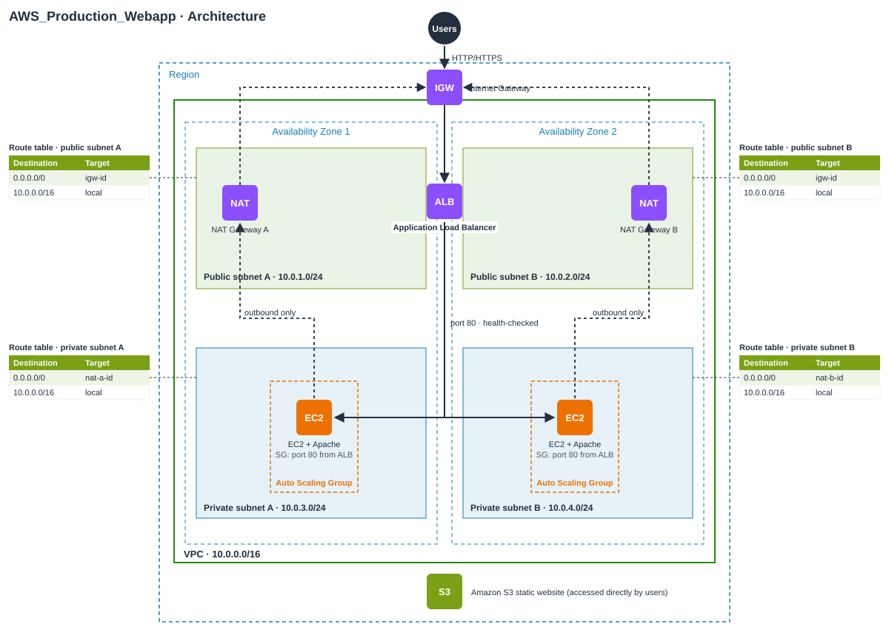

# 🚀 AWS Production-Style Web Application

A hands-on AWS cloud engineering project focused on deploying, securing, and scaling a web application using core AWS services.

This project uses my personal profile website as the application and progressively builds a production-style AWS infrastructure, covering compute, networking, storage, load balancing, auto scaling, and high availability.

> **Project status:** In Progress 🚧

## 🎯 Project Objectives

- Deploy a web application on Amazon EC2.
- Build a custom and secure Amazon VPC.
- Understand public and private subnet architecture.
- Configure Internet Gateway, NAT Gateway, and route tables.
- Host static website content using Amazon S3.
- Configure an Application Load Balancer.
- Implement Auto Scaling across multiple Availability Zones.
- Test application availability and instance recovery.

## 🏗️ Planned AWS Architecture

The target architecture will use a custom VPC distributed across two Availability Zones.




*Note: This is the planned target architecture. The diagram will be updated as AWS resources are implemented and verified.*

## ☁️ AWS Services

| AWS Service | Purpose |
|---|---|
| Amazon EC2 | Hosts the personal profile web application |
| Amazon VPC | Provides isolated network infrastructure |
| Public Subnets | Host internet-facing resources such as the ALB |
| Private Subnets | Host application EC2 instances |
| Internet Gateway | Enables internet connectivity |
| NAT Gateway | Provides outbound internet access for private instances |
| Security Groups | Control network traffic |
| Amazon S3 | Stores static website files and assets |
| Application Load Balancer | Distributes incoming application traffic |
| Auto Scaling Group | Maintains EC2 instance capacity across AZs |

## 🛠️ Technology Stack

- **Cloud Platform:** Amazon Web Services (AWS)
- **Application:** HTML, CSS
- **Web Server:** Apache HTTP Server
- **Version Control:** Git and GitHub
- **Operating System:** Amazon Linux 2023
- **Networking:** VPC, Subnets, Route Tables, Internet Gateway, NAT Gateway
- **Availability:** Application Load Balancer and Auto Scaling

## 📌 Implementation Roadmap

| Phase | Implementation | Status |
|---|---|---|
| 1 | Personal Profile Website + GitHub | ✅ Completed |
| 2 | First EC2 Deployment | ⏳ Planned |
| 3 | Custom VPC + Public/Private Subnets | ⏳ Planned |
| 4 | Internet Gateway, NAT Gateway + Route Tables | ⏳ Planned |
| 5 | Security Groups | ⏳ Planned |
| 6 | S3 Static Website Hosting | ⏳ Planned |
| 7 | ALB + Auto Scaling across Two AZs | ⏳ Planned |
| 8 | Failure Simulation + Recovery Testing | ⏳ Planned |

## 🧪 Testing and Validation

The project will include practical validation of each AWS component:

- **EC2:** Verify that the personal profile website loads successfully.
- **VPC:** Validate subnet configuration and network routing.
- **Security Groups:** Verify permitted and restricted traffic.
- **S3:** Confirm that the static website is accessible through its configured endpoint.
- **ALB:** Verify traffic distribution to healthy EC2 targets.
- **Auto Scaling:** Terminate an instance and verify automatic replacement.
- **High Availability:** Verify application access when an individual application instance becomes unhealthy.

## 📂 Repository Structure

```text
AWS_Production_Webapp/
│
├── application/
│   ├── index.html
│   └── style.css
│
└── README.md
```

## 📸 Project Evidence

Screenshots, AWS configuration details, deployment results, and testing evidence will be added here as each phase is completed.

## 💡 Key Learning Outcomes

By completing this project, I aim to demonstrate practical knowledge of:

- AWS infrastructure provisioning and configuration.
- Cloud networking and subnet design.
- Secure application deployment.
- Load balancing and horizontal scaling.
- Multi-AZ application architecture.
- Troubleshooting and recovery of cloud resources.

---

**Author:** Swathi  
**GitHub Repository:** [AWS_Production_Webapp](https://github.com/swathikaJana/AWS_Production_Webapp)

*Learning by building. Building by doing.*
