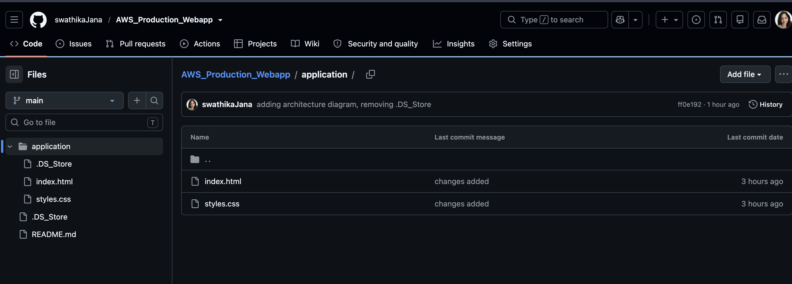
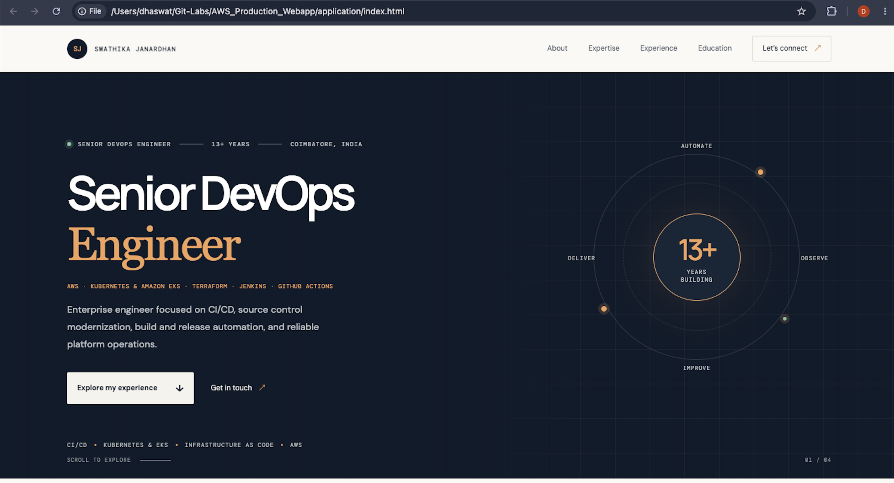
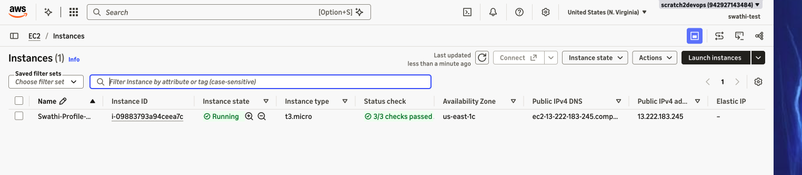
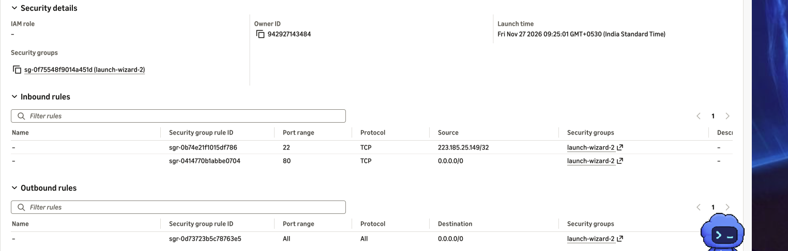
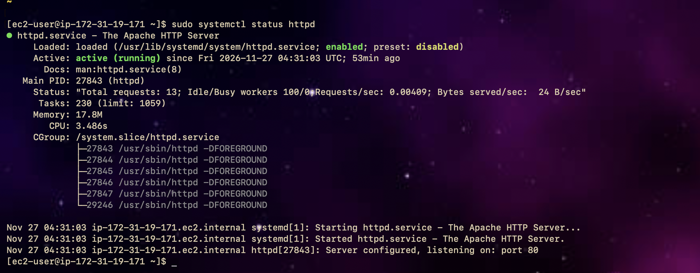
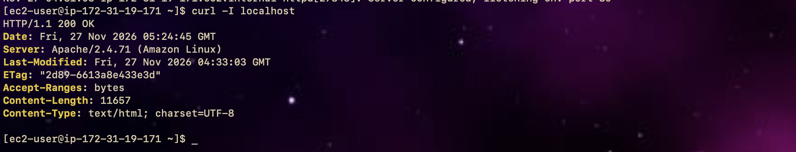
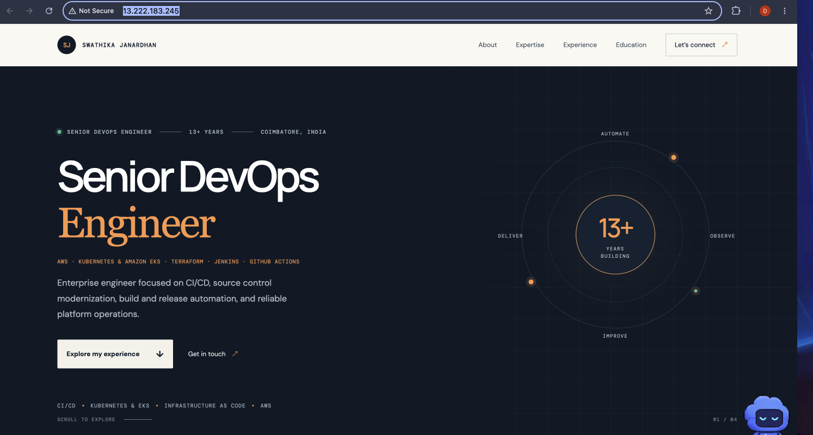
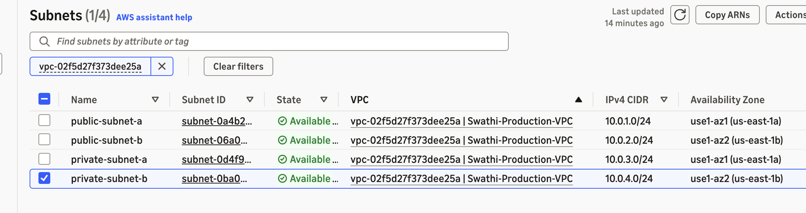
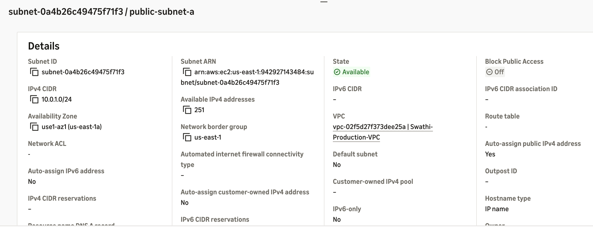
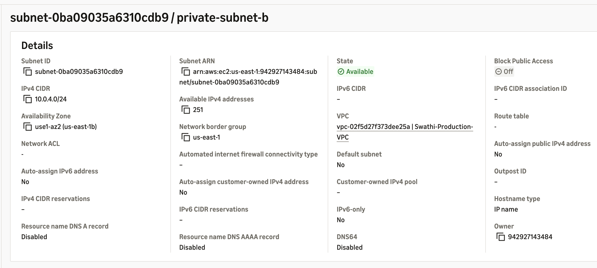

# 🚀 AWS Production-Style Web Application

A hands-on AWS cloud engineering project focused on deploying, securing, and scaling a web application using core AWS services.

This project uses my personal profile website as the application and progressively builds a production-style AWS infrastructure, covering compute, networking, storage, load balancing, auto scaling, and high availability.

> **Project status:** In Progress 🚧

## 🎯 Project Objectives

- Deploy a web application on Amazon EC2.
- Build a custom and secure Amazon VPC.
- Understand public and private subnet architecture.
- Configure Internet Gateway, NAT Gateway, and route tables.
- Host static website content using Amazon S3.
- Configure an Application Load Balancer.
- Implement Auto Scaling across multiple Availability Zones.
- Test application availability and instance recovery.

## 🏗️ Planned AWS Architecture

The target architecture will use a custom VPC distributed across two Availability Zones.


*Note: This is the planned target architecture. The diagram will be updated as AWS resources are implemented and verified.*

## ☁️ AWS Services

| AWS Service | Purpose |
|---|---|
| Amazon EC2 | Hosts the personal profile web application |
| Amazon VPC | Provides isolated network infrastructure |
| Public Subnets | Host internet-facing resources such as the ALB |
| Private Subnets | Host application EC2 instances |
| Internet Gateway | Enables internet connectivity |
| NAT Gateway | Provides outbound internet access for private instances |
| Security Groups | Control network traffic |
| Amazon S3 | Stores static website files and assets |
| Application Load Balancer | Distributes incoming application traffic |
| Auto Scaling Group | Maintains EC2 instance capacity across AZs |

## 🛠️ Technology Stack

- **Cloud Platform:** Amazon Web Services (AWS)
- **Application:** HTML, CSS
- **Web Server:** Apache HTTP Server
- **Version Control:** Git and GitHub
- **Operating System:** Amazon Linux 2023
- **Networking:** VPC, Subnets, Route Tables, Internet Gateway, NAT Gateway
- **Availability:** Application Load Balancer and Auto Scaling

## 📌 Implementation Roadmap

| Phase | Implementation | Status |
|---|---|---|
| 1 | Personal Profile Website + GitHub | ✅ Completed |
| 2 | First EC2 Deployment | ✅ Completed|
| 3 | Custom VPC + Public/Private Subnets | ✅ Completed |
| 4 | Internet Gateway, NAT Gateway + Route Tables | ⏳ Planned |
| 5 | Security Groups | ⏳ Planned |
| 6 | S3 Static Website Hosting | ⏳ Planned |
| 7 | ALB + Auto Scaling across Two AZs | ⏳ Planned |
| 8 | Failure Simulation + Recovery Testing | ⏳ Planned |

## 🧪 Testing and Validation

The project will include practical validation of each AWS component:

- **EC2:** Verify that the personal profile website loads successfully.
- **VPC:** Validate subnet configuration and network routing.
- **Security Groups:** Verify permitted and restricted traffic.
- **S3:** Confirm that the static website is accessible through its configured endpoint.
- **ALB:** Verify traffic distribution to healthy EC2 targets.
- **Auto Scaling:** Terminate an instance and verify automatic replacement.
- **High Availability:** Verify application access when an individual application instance becomes unhealthy.

## 📂 Repository Structure

```text
AWS_Production_Webapp/
│
├── application/
│   ├── index.html
│   └── style.css
├── screenshots/
│   └── phase2-ec2.png
│
├── architecture.svg
├── .gitignore
└── README.md
```

## 📸 Project Evidence

### Phase 1: Personal Profile Website + GitHub ✅



- Built a responsive profile site with HTML and CSS
- Version-controlled with Git and published to GitHub
- Verified the page renders correctly locally before deployment

### Phase 2: First EC2 Deployment ✅

**EC2 instance running**


**Security group inbound rules**


**Apache running on the server**


**Page served locally (`curl -I localhost`)**


**Page loaded in a browser from the internet**



- **AMI:** Amazon Linux 2023
- **Instance type:** t3.micro
- **Web server:** Apache (`httpd`) installed with `dnf`
- **Security group:** SSH (22) from my IP only, HTTP (80) from anywhere
- **Verification:** `curl localhost` returned the HTML, and the page loaded in a browser at the instance's public IPv4 address
<details>
<summary><b>Deployment commands (Phase 2)</b></summary>

```bash
# Update installed packages
sudo dnf update -y

# Install Apache web server and Git
sudo dnf install -y httpd git

# Start Apache now and on every reboot
sudo systemctl enable --now httpd

# Pull the application code from GitHub
git clone https://github.com/swathikaJana/AWS_Production_Webapp.git

# Publish the site to Apache's web root
sudo cp AWS_Production_Webapp/application/* /var/www/html/
```

</details>

### Phase 3: Custom VPC + Public/Private Subnets ✅

**VPC**


**Subnets across two Availability Zones**


**Public vs private subnet settings**

| Public subnet | Private subnet |
|---|---|
|  |  |

| Resource | Name | CIDR | Availability Zone |
|---|---|---|---|
| VPC | Swathi-Production-VPC | 10.0.0.0/16 | us-east-1 (region) |
| Public subnet | public-subnet-a | 10.0.1.0/24 | us-east-1a |
| Public subnet | public-subnet-b | 10.0.2.0/24 | us-east-1b |
| Private subnet | private-subnet-a | 10.0.3.0/24 | us-east-1a |
| Private subnet | private-subnet-b | 10.0.4.0/24 | us-east-1b |

- Created the VPC manually with a custom CIDR instead of using the default VPC or the "VPC and more" wizard
- Enabled DNS hostnames on the VPC
- Placed one public and one private subnet in each of two AZs for high availability
- Enabled auto-assign public IPv4 on the public subnets only
- **Verification:** all four subnets show Available, belong to the custom VPC, have non-overlapping CIDRs, and are split correctly across `us-east-1a` and `us-east-1b`
- **Note:** the public subnets are not yet routable to the internet. The Internet Gateway and route tables come in Phase 4.


*Evidence for later phases will be added as each one is verified.*

## 💡 Key Learning Outcomes

By completing this project, I aim to demonstrate practical knowledge of:

- AWS infrastructure provisioning and configuration.
- Cloud networking and subnet design.
- Secure application deployment.
- Load balancing and horizontal scaling.
- Multi-AZ application architecture.
- Troubleshooting and recovery of cloud resources.

---

**Author:** Swathi  
**GitHub Repository:** [AWS_Production_Webapp](https://github.com/swathikaJana/AWS_Production_Webapp)

*Learning by building. Building by doing.*
